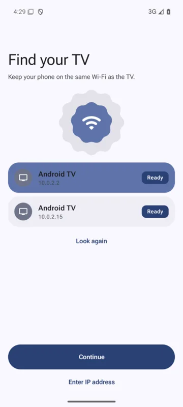
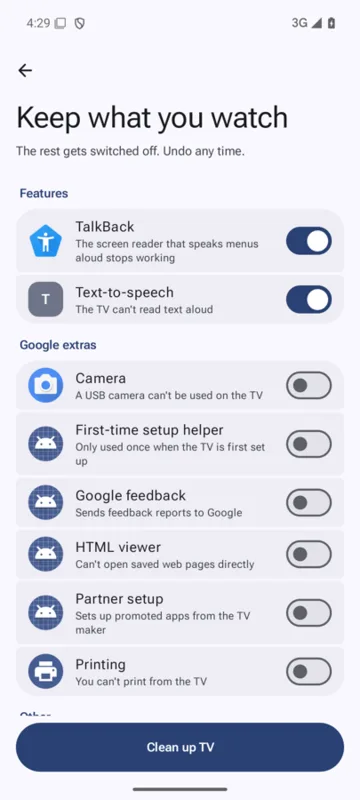
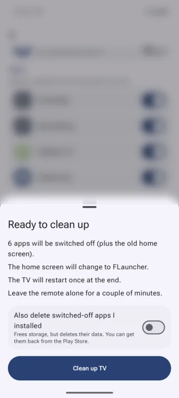
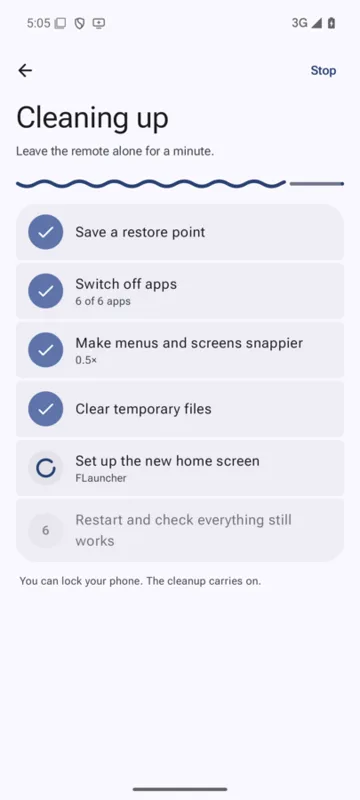
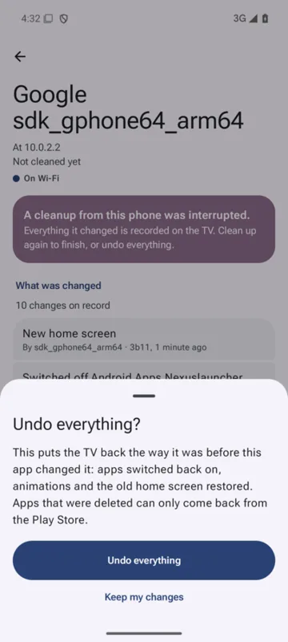
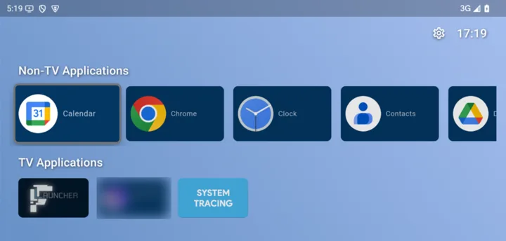

<h1 align="center">
  <br>
  ExBloat TV
</h1>

<p align="center">
  Clean up an Android TV or Google TV box from your phone. Switch off the apps you never use, speed it up, swap the ad-filled home screen, and undo it all with one button.
</p>

<p align="center">
  <a href="LICENSE"></a>
  <a href="https://github.com/XploreDatum/exbloattv/releases/latest"></a>
  
  <a href="https://github.com/XploreDatum/exbloattv/actions/workflows/ci.yml"></a>
</p>

---

ExBloat TV is an Android **phone** app. It finds the TV on your home Wi-Fi, shows you every app on it in plain groups, and switches off the ones you don't want. Nothing is switched off without you seeing it in a list first. Every change is recorded on the TV itself, so any phone at home can undo it later.

No computer, no root, no account.

## Screenshots

| Find your TV | Keep what you watch | Review | Cleaning up | Undo |
|:---:|:---:|:---:|:---:|:---:|
|  |  |  |  |  |

<p align="center">
  <br>
  <sub>The new home screen (FLauncher) after a cleanup.</sub>
</p>

<sub>These screenshots come from test runs where an Android emulator played the part of the TV, so the "TV" is named after the emulator and the app lists are an emulator's. One app tile and the list behind the Review sheet are blurred because they belong to unrelated apps on the test device.</sub>

## Features

- **Finds the TV for you.** Scans your home Wi-Fi and lists the Android TV boxes it finds. You can also type the TV's address.
- **Walks you through setup.** Step-by-step instructions to turn on debugging for Android TV, Google TV, Xiaomi Mi Box / Mi TV, TCL, Sony, Hisense, Philips and Fire TV, with simple pictures of each step.
- **Shows every app in plain groups.** Streaming video, Music & audio, Live TV & sports, Features, Google extras, Manufacturer extras, Store & sideload tools, Ads & tracking, and Other for apps it doesn't recognise.
- **Sensible defaults.** Streaming, music, live TV, voice search, casting, screensaver and accessibility stay on. Google and manufacturer extras start switched off. Ads & tracking apps are always switched off unless you unlock them under Advanced.
- **Switches off, doesn't delete.** Apps are disabled, so their data is kept and they can come back. Deleting apps you installed is a separate switch, off by default.
- **Makes it faster.** Faster animations, stops video apps running in the background, clears app caches.
- **New home screen.** Optionally installs [FLauncher](https://gitlab.com/flauncher/flauncher), a simple home screen without ads. The download is checked against a fixed SHA-256 before it is installed.
- **Checks its own work.** Every change is read back from the TV before it counts. The TV restarts once at the end and the app checks everything stayed the way you chose.
- **Undo everything.** One button puts the TV back the way it was before the app changed it.
- **Safe for the whole family.** A built-in list of apps the TV needs is never touched, whatever is chosen. Two phones can't clean the same TV at once. A cleanup that is cut off (phone locked, Wi-Fi drops, TV loses power) can be finished or undone later.

## How it works

1. **Find the TV.** Your phone looks for TVs on the same Wi-Fi.
2. **Turn on debugging.** Follow the steps for your TV brand, then press OK on **"Allow USB debugging?"** on the TV. Tick **Always allow** first.
3. **Choose what to keep.** The app reads every app on the TV and sorts it into groups. Flip the switches; on means keep.
4. **Clean up.** Tap **Clean up TV**, check the summary, and tap **Clean up TV** again. Leave the remote alone for a couple of minutes while the TV restarts.
5. **Undo any time.** From the TV's page in the app, **Undo everything** reverses what the app changed.

For the details, see [How it works](docs/how-it-works.md).

## Download and install

1. On your phone, open the [latest release](https://github.com/XploreDatum/exbloattv/releases/latest) and download `ExBloatTV-1.0.0.apk`.
2. Open the downloaded file. Android asks you to allow your browser or file manager to install unknown apps; allow it for this install.
3. Open **ExBloat TV**.

The app is not on the Play Store.

**Check the download (optional).** Each release has a `SHA256SUMS.txt` file. On a computer:

```sh
# macOS
shasum -a 256 -c SHA256SUMS.txt
# Linux
sha256sum -c SHA256SUMS.txt
```

Both should print `ExBloatTV-1.0.0.apk: OK`.

## Quick start

1. Put your phone on the same Wi-Fi as the TV. Mobile data can't reach the TV.
2. Open ExBloat TV. The first time, it opens on **Find your TV** (later, tap **Add a TV**). Pick your TV from the list and tap **Continue**.
3. Follow **Turn on debugging** on the TV. The app moves on by itself when the TV is ready.
4. On the TV, tick **Always allow** and press OK on **"Allow USB debugging?"**.
5. On **Keep what you watch**, check the switches, then tap **Clean up TV**.

The [user guide](docs/user-guide.md) walks through each screen, written for someone who has never done this before.

## Supported TVs

The phone needs **Android 8.0 or newer**. The TV needs to be an Android TV or Google TV device that can turn on **USB debugging** (sometimes called network debugging), which lets the phone connect over Wi-Fi on port 5555.

What has been tested, honestly:

| | Status |
|---|---|
| Android 15 emulator acting as the TV | Tested end to end: find, connect, clean up, new home screen, restart, recovery after the restart, Undo, Stop. |
| Xiaomi Mi Box 4 (Android 9) | The app was built against real command output captured from this box (in [`fixtures/`](fixtures/)) and its unit tests run on that output. A full cleanup run on a real TV has not been recorded yet. |
| Other brands (Google TV, TCL, Sony, Hisense, Philips) | Setup steps are included. Not yet tested on real hardware. |
| Fire TV | Setup steps are included and the cleanup runs, but the home screen is left as it is: there is no FLauncher swap on Fire TV yet. Not yet tested on a real Fire TV. |
| TVs that only offer **Wireless debugging** with a pairing code | Not supported yet. The app needs classic USB/network debugging. |

If you try it on your TV, please send a [TV compatibility report](https://github.com/XploreDatum/exbloattv/issues/new?template=tv_report.yml), whether it worked or not.

## Safety and undo

- A fixed list of packages the TV needs (system UI, settings, Play Store and Play services, Bluetooth, Wi-Fi, the remote and keyboard services, chip-maker system apps and more) is checked right before every change. They are never switched off, whatever the screen sends.
- The current home screen is never switched off until FLauncher is confirmed working as the new one. If FLauncher doesn't come up, the old home screen is put back straight away.
- Every change is written to a log on the TV **before** it is made, then marked as confirmed once the TV shows it took. A cleanup cut off at any point can be undone.
- **Undo everything** switches apps back on, brings back anything removed, restores the animation speed and background settings, brings back the old home screen and removes FLauncher if the app installed it.
- **What Undo can't do:** apps you chose to *delete* (the separate, off-by-default switch) lose their data, and only the Play Store can bring them back. The app offers an **Open in Play Store on the TV** button for each one. Cleared caches are temporary files and are not restored.

More in [Safety](docs/safety.md).

## Privacy

- No analytics, no ads, no accounts, no crash reporting.
- The app talks to the TV over your home network. To find it, it tries a few ports on each address of your Wi-Fi network (at most 254 addresses) and listens for TVs announcing themselves.
- The only internet request is the FLauncher download from GitLab, and only when you leave **New home screen (FLauncher)** on and FLauncher isn't already on the TV. (Links on the **About** screen open in your browser.)
- The app's own files (including its connection key) are excluded from phone backups and device-to-device transfers.

## Build from source

You need JDK 17 and the Android SDK (platform 36).

```sh
git clone https://github.com/XploreDatum/exbloattv.git
cd exbloattv
./gradlew testDebugUnitTest assembleDebug
```

The debug APK is written to `app/build/outputs/apk/debug/app-debug.apk`. Release signing, testing against an emulator and the project layout are in [Building](docs/building.md).

## Documentation

- [User guide](docs/user-guide.md): step by step, for anyone at home
- [How it works](docs/how-it-works.md): architecture for developers
- [Safety](docs/safety.md): what is never touched and how Undo works
- [Troubleshooting](docs/troubleshooting.md)
- [FAQ](docs/faq.md)
- [Building](docs/building.md)
- [App catalog](docs/catalog.md): how apps are sorted into groups, and how to add some
- [Command-line version (macOS/Linux)](docs/cli.md)
- [All docs](docs/README.md)

## Contributing

Bug reports, TV compatibility reports and catalog additions are very welcome. Please read [CONTRIBUTING.md](CONTRIBUTING.md) and the [Code of Conduct](CODE_OF_CONDUCT.md). To report a security problem, see [SECURITY.md](SECURITY.md).

## Licence and attribution

ExBloat TV is released under the [MIT Licence](LICENSE).

It builds on the work of others:

- **[FLauncher](https://gitlab.com/flauncher/flauncher)** by Étienne Fesser (GPL-3.0-or-later): the home screen the app can install. It is downloaded from FLauncher's own releases at cleanup time and is not bundled in this app.
- **[dadb](https://github.com/mobile-dev-inc/dadb)** (Apache-2.0): the Kotlin ADB client the app uses to talk to the TV.
- **[android-tv-tune](https://github.com/ohernandezdev/android-tv-tune)** by Omar Hernandez (MIT): its app lists seeded the catalog and the never-touch list. The licence text is in [`catalog-seed/android-tv-tune.LICENSE`](catalog-seed/android-tv-tune.LICENSE).

Full third-party notices are in [THIRD_PARTY_NOTICES.md](THIRD_PARTY_NOTICES.md), and in the app under **About → Open-source licences**.

## Disclaimer

ExBloat TV is an independent project. It is not affiliated with, endorsed by or sponsored by Google, Amazon, Xiaomi, TCL, Sony, Hisense, Philips or any other TV or app maker. Android, Android TV, Google TV and other product names are trademarks of their owners and are used here only to describe which devices the app works with.

Use it at your own risk. The app is built to be reversible: everything it changes can be undone with **Undo everything**, except deleting apps you installed (which only happens if you turn that switch on) and clearing caches. The software is provided "as is", without warranty of any kind; see the [licence](LICENSE).
