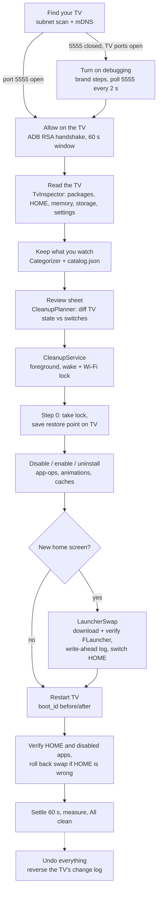

# How it works

This page is for developers. It explains how ExBloat TV finds a TV, talks to it, decides what to change, makes the changes safely and undoes them. For the user-facing view, see the [user guide](user-guide.md).

The original design is in [`docs/superpowers/specs/2026-10-21-exbloattv-design.md`](superpowers/specs/2026-10-21-exbloattv-design.md); section 12a lists the decisions made after the first review. Where the code and the spec differ, the code is right.

## The big picture

The phone does all the work. Nothing is installed on the TV except, optionally, FLauncher. The phone talks to the TV's own debugging service (ADB) over the home network, runs ordinary shell commands (`pm`, `cmd package`, `settings`, `cmd appops`), and reads the TV back after every change to confirm it took.



## Package map

All app code is under `app/src/main/java/dev/xpdt/exbloattv/`.

| Package | What it does |
|---|---|
| `ExBloatApp.kt` | `Application` plus `AppGraph`, a hand-written object graph built once per process (no DI framework). |
| `adb/` | `AdbClient` (shell, install, push, pull, reboot) and `AdbConnector`. `DadbConnector` / `DadbAdbClient` implement them with [dadb](https://github.com/mobile-dev-inc/dadb). `RawAdbConnection.java` is a small shim (see below). `AdbKeys` stores the phone's RSA key. `AdbErrors.kt` maps socket and dadb failures to `AdbError.Unauthorized`, `Refused`, `Timeout`, `Disconnected`, `TransferFailed`, `LocalFile`. |
| `discovery/` | `Discovery` (subnet scan plus mDNS, merged by address), `SubnetScanner`, `WifiNetworkProvider` (finds the phone's Wi-Fi and binds sockets to it). |
| `tv/` | `TvInspector` runs read-only commands and builds an `Inventory`. `Parsers` turns command output into data. `Model.kt` holds the data classes. |
| `catalog/` | `Catalog` (loads `assets/catalog.json`) and `Categorizer` (inventory to grouped, named apps with defaults). |
| `apps/` | `AppLabelResolver`: real app names and icons, pulled from the TV lazily. |
| `safety/` | `SafetyGuard`: the never-touch list, checked right before every change. |
| `cleanup/` | `Choices`, `CleanupPlanner` (pure: inventory + choices to `Step`s), `CleanupRunner` (runs steps with verification and logging), `LauncherSwap`, `ApkDownloader`, `Undo`. |
| `state/` | `TvState` and `TvStateStore`: the shared state file on the TV. |
| `data/` | `TvRepository` (phone-side DataStore: remembered TVs, last choices, install id, the running job) and `TvSession` (TVs read in this session). |
| `service/` | `CleanupService` (foreground service), `CleanupWork` (process-wide owner of cleanup and undo runs), `KeepAwake` (wake lock + Wi-Fi lock), result summaries. |
| `ui/` | Jetpack Compose with Material 3 Expressive: `nav/NavGraph.kt`, one file per screen in `screens/`, shared pieces in `components/`, colours and type in `theme/`. |

## Talking to the TV: ADB over TCP

The TV's debugging service listens on TCP port **5555** once USB/network debugging is on. The app speaks the ADB protocol directly using dadb (`dev.mobile:dadb`), a pure-Kotlin ADB client.

**Keys.** On first use the app generates an RSA-2048 key pair and stores it as `adbkey` and `adbkey.pub` in its private files directory (`files/adb/`). The public key's comment is `exbloattv@<phone model>`, which is the name the TV shows in its **"Allow USB debugging?"** prompt. Reusing the same key keeps the TV's **Always allow** approval valid. A key pair that can't be read is renamed to `*.bad-<time>` and replaced, so connecting keeps working; the TV then asks once more. App backups and device transfers exclude all of the app's files (`allowBackup="false"` and `data_extraction_rules.xml`), so the private key never leaves the phone.

**Why `RawAdbConnection.java`.** dadb's `Dadb.create` keeps its socket private until the handshake finishes, and the handshake blocks until someone presses OK on the TV. A blocking read can't be cancelled, only ended by closing the socket. dadb's `AdbConnection` is Kotlin-`internal` (public in bytecode), so Kotlin code in this app can't name it; a tiny Java class can. With it, `DadbConnector` opens and owns the socket, runs dadb's handshake on it, and closes the socket on timeout or cancel.

**Connecting** (`DadbConnector.connect`): bind the socket to the Wi-Fi network, connect with a 10 s timeout, then run the handshake. A failure after the TCP connection is up, or running out of time during the handshake, means "not approved yet" (`Unauthorized`). A refused connection means debugging is off (`Refused`). The Approve screen keeps retrying for up to 60 seconds.

**Every call has a deadline.** A TV that leaves the Wi-Fi without closing TCP would block a read forever. `CleanupRunner` wraps the client in `TimedAdbClient` (60 s per shell command, 5 min per install, 2 min per transfer) and `LauncherSwap` and `Undo` bound their own calls (10 s each, 30 s for state-file operations). On timeout the connection is closed and the step is retried on a new one.

## Discovery

`Discovery.scan()` merges two sources into one stream of `FoundTv(host, readiness, name)`:

- **Subnet scan** (`SubnetScanner`). Takes the phone's Wi-Fi IPv4 address and prefix, never wider than a /24 (so at most 254 hosts), skips the phone itself and probes each host with a plain TCP connect (800 ms timeout, 64 hosts at a time). Port **5555** open means **Ready**. If 5555 is closed but **6466/6467** (Android TV Remote service) or **8008/8009** (Cast) answer, it is a TV that needs setup.
- **mDNS** (`NsdManager`) for `_adb._tcp` and `_androidtvremote2._tcp`, used for friendly names. An mDNS hit is only Ready if port 5555 actually answers, because on Android 11+ `_adb._tcp` is the TLS wireless-debugging service on a random port.

**Wi-Fi binding.** `WifiNetworkProvider` looks at all of the phone's networks, not only the default one. A home Wi-Fi without internet, or a phone that prefers mobile data, still reaches the TV. Every TV socket (probes and ADB) is bound to that Wi-Fi network with `Network.bindSocket`. If binding is refused (for example by an always-on VPN that blocks other networks), the socket falls back to default routing; binding never decides on its own whether a TV is there.

TVs are remembered by serial (`ro.serialno`, falling back to `ro.boot.serialno`), not by IP, so a TV whose address changed is recognised and its record updated.

## Inventory and categories

`TvInspector.read()` runs only read-only commands:

- `getprop` (model, brand, manufacturer, Android version, serial)
- `pm list packages -f -i -U`, `-s` (system), `-d` (disabled), `-u` (to find apps removed for the user)
- `cmd package query-activities` for `LEANBACK_LAUNCHER`, `LAUNCHER` and `HOME`, and `cmd package resolve-activity --brief` for the current HOME
- `dumpsys meminfo` and `df /data` (optional; a failed read shows a dash, never zero)
- `settings get global` for the three animation scales
- `cmd appops get <pkg> RUN_ANY_IN_BACKGROUND` for launchable user apps

A read that fails or returns an error throws `TvReadException`; it never passes for "nothing installed" or "switched off".

`Categorizer` turns each package into a `CategorizedApp`:

1. Anything `SafetyGuard` protects becomes **System** (hidden, never changed), whatever the catalog says.
2. Otherwise a catalog match gives the category, name, description, default and flags.
3. An unknown package that can be HOME becomes **Launcher** (hidden, kept).
4. An unknown system package becomes **System**; an unknown user-installed package becomes **Other** (shown, kept by default).

See [catalog.md](catalog.md) for the file format and rules.

Names and icons for apps come from the catalog first. For the rest, `AppLabelResolver` pulls the APK to the phone's cache (skipped if over 40 MB, or if the phone has less than 200 MB free), reads its label and icon with `PackageManager.getPackageArchiveInfo`, and caches the result by package and version code.

## Planning

`CleanupPlanner.plan(apps, inventory, choices, removedForUser)` is pure. The switches describe the **end state**; the plan is the difference between that and the TV as it is now:

- switched off, currently on: `Disable` (or `Uninstall` for a user-installed app when **Also delete switched-off apps I installed** is on);
- switched on, currently off: `Enable`; switched on, removed for the user: `InstallExisting`;
- already in the right state: nothing.

Then, in order: background restrictions for kept, launchable streaming and live-TV apps that aren't music apps; `SetAnimations(0.5)` if any scale differs; `TrimCaches`; `SwapLauncher` (not on Fire TV, not if FLauncher is already HOME); and `RebootAndVerify` if anything was disabled or the launcher swapped. Locked rows (ads & tracking, launchers) always use their default. Protected packages and the current HOME are never planned for disabling.

## Running

`CleanupWork` owns runs for the whole process. Screens start a job there; `CleanupService` (a foreground service of type `dataSync`) picks it up so the run carries on with the phone locked. While a job runs, `AndroidKeepAwake` holds a partial wake lock and a Wi-Fi lock (low-latency on Android 10+, high-performance before), both released after 30 minutes at most. The running job is also written to DataStore (`ActiveJob`), so if the app is killed the home screen can say the work was interrupted.

`CleanupRunner.run(plan, before)` emits `RunProgress` as it goes:

1. **Step 0, always:** take the TV lock, save the restore point (`original` only if there is none, `latest` every time), then call `LauncherSwap.recover` in case an earlier swap was cut off.
2. **Each step:** re-take the lock as this phone; check that no other phone changed the log in the meantime (if one did, the run stops and asks the person to read the TV again); then read, change, verify and log.
3. **Write-ahead logging:** before each command, an unverified `Change` is appended to the TV's log, with the `from` state read just then. After the command the TV is read back: if the change took, the entry is marked verified; if nothing changed, it is dropped; if the TV can't be read, it stays unverified ("maybe happened"), which Undo reverses harmlessly.
4. **Disable** uses `pm disable-user --user 0`. If the TV prints success but the app is still on, and the app came with the TV, the fallback is `pm uninstall -k --user 0` (removed for the user, data kept), logged as `REMOVE_FOR_USER` so Undo uses `cmd package install-existing`. User-installed apps never get this fallback.
5. **Failures** mark the step FAILED with a plain message and the run moves on. Lost connections are retried after 2 s, 5 s and 10 s; after that the run pauses until **Retry** or **Skip**.
6. **Stop** cancels the run. Each step's read–change–verify–log runs to the end regardless (`NonCancellable`), so the log is never half-written. Stop is also checked right before a restart, so a stopped run never restarts the TV. The lock is released.
7. **Restart** (`RebootAndVerify`): read `/proc/sys/kernel/random/boot_id`, reboot, wait for the old connection to drop, reconnect every 5 s for up to 3 minutes until `sys.boot_completed` is 1, and read `boot_id` again. Only a different `boot_id` proves the restart happened. Then press HOME, confirm FLauncher (rolling the swap back if not) and confirm that every app this run switched off is still off.

After the steps, `CleanupWork` waits 60 seconds for the TV to settle, reads it again for the "after" numbers and shows the summary. Only verified changes are counted.

## The launcher swap

`LauncherSwap` replaces the stock home screen with FLauncher 0.18.0:

1. Skip on Fire TV (`ro.product.manufacturer` is Amazon).
2. If FLauncher isn't installed: download it with `ApkDownloader` from FLauncher's GitLab package registry, verify SHA-256 `376fc528…af32e` (a mismatch deletes the file and stops), log `:install`, install, confirm. If the person's own FLauncher is switched off, log `:enable` and switch it on.
3. Launch FLauncher and confirm it is in front.
4. For each stock HOME package (never `com.android.tv.settings`, never anything `SafetyGuard` protects) and the setup wizard `com.google.android.tungsten.setupwraith` (which otherwise takes HOME back), log `:disable:<pkg>`, run `pm disable-user --user 0`, confirm.
5. Press HOME and confirm both that HOME resolves to FLauncher and that it is in front. Only then log `:home` (`LAUNCHER_SWAP`), which marks the swap finished.

All entries of one swap share an id prefix `swap-<time>-<random>:`. **A swap without a verified `:home` entry is unfinished.** Whenever the app connects again (in the runner, after a restart, in Undo), `recover` rolls an unfinished swap back: switch every logged package back on, remove FLauncher only if this swap installed it and a real home screen is confirmed back, press HOME and check the old home screen is in front. `cmd package set-home-activity` is never used.

## The state file on the TV

Everything a phone needs to undo a cleanup lives on the TV, so any phone at home can see and undo what any other phone did.

- Path: `/data/local/tmp/exbloattv/state.json`. The ADB shell can write there, TV apps can't read it, and it survives restarts. Only a factory reset wipes it.
- Writes are atomic: the JSON is base64-encoded, written in chunks to a unique temp file with `echo … | base64 -d`, then `mv`'d over the real file.
- A file that isn't ours, or belongs to another TV serial, is set aside as `state.json.bad-<time>`. A file from a newer app version (higher `version`, or content this version can't decode) is never overwritten; the app asks the person to update instead.

Format (`version` 1):

```json
{
  "version": 1,
  "serial": "ABC123",
  "original": { "takenAt": 0, "byPhone": "Pixel 8 · 3f9a", "enabled": [], "disabled": [],
                "userInstalled": [], "resolvedHome": "com.google.android.tvlauncher/.MainActivity",
                "animations": { "window": 1.0, "transition": 1.0, "animator": 1.0 },
                "backgroundOps": { "com.example.app": "allow" } },
  "latest": { "...": "same shape, taken at the start of every run" },
  "changes": [
    { "id": "run-…:3:…", "kind": "DISABLE", "pkg": "com.example.app",
      "from": "enabled", "to": "disabled", "byPhone": "Pixel 8 · 3f9a",
      "at": 0, "verified": true }
  ],
  "lock": { "byPhone": "Pixel 8 · 3f9a", "at": 0 }
}
```

`kind` is one of `DISABLE`, `ENABLE`, `REMOVE_FOR_USER`, `INSTALL_EXISTING`, `UNINSTALL`, `ANIMATIONS` (`from`/`to` are the three raw scales joined by commas, with `null` for "never set"), `APPOPS` (`from` like `RUN_IN_BACKGROUND=allow`), `INSTALL_APK` and `LAUNCHER_SWAP`. A phone is named `<model> · <first 4 characters of a random install id>`.

**The lock.** `acquireLock` refuses if another phone holds a lock younger than 10 minutes. Two phones could read at the same moment, so after writing its lock a phone reads the file back and only goes ahead if the lock is still its own. The runner refreshes the lock before every step, so a long run never expires into another phone's hands; a phone that disappears mid-run lets go after 10 minutes.

## Undo

`Undo.undoAll` takes the lock and walks the change log **newest first**, whichever phone made each change:

| Logged change | Reversal |
|---|---|
| `DISABLE` | `pm enable` |
| `REMOVE_FOR_USER` | `cmd package install-existing`, then `pm enable` if needed |
| `ENABLE` | `pm disable-user --user 0` |
| `INSTALL_EXISTING` | `pm uninstall -k --user 0` |
| `ANIMATIONS` | `settings put global …` back to the old values (`settings delete` for "never set") |
| `APPOPS` | `cmd appops set <pkg> <op> <old mode>` |
| swap entries | rolled back as one unit by `LauncherSwap` (see above) |
| `UNINSTALL` | can't be reversed over ADB; listed for **Open in Play Store on the TV** |

Each reversal is read back before its entry is dropped from the log, one entry per write, so an Undo cut off anywhere resumes cleanly next time. If a reversal fails, it stays logged and older changes to the same package wait, so the log always describes the TV. Package names, scales and app-op modes from the log are validated before they go into a command. At the end HOME is pressed and a real stock home screen must come to the front.

## Recovery after interruptions

| What happened | What the app does |
|---|---|
| Wi-Fi dropped or the TV slept mid-run | Reconnect after 2 s, 5 s, 10 s and retry the same step; then pause with **Retry** / **Skip**. Each new connection runs `LauncherSwap.recover` first. |
| Phone app killed or phone restarted | The `ActiveJob` record survives in DataStore. Home and the TV page say the work was interrupted and offer **Clean up again** or **Undo everything**. The lock expires after 10 minutes. |
| TV lost power mid-run | The log already has a write-ahead entry for the step in progress. On the next connection an unfinished launcher swap is rolled back. Undo reverses unverified entries harmlessly. |
| Restart command lost | The `boot_id` comparison catches it; the step fails with "The TV didn't restart" and a retry restarts it. |
| HOME isn't FLauncher after the restart | The swap is rolled back automatically and the step reports why. |
| Another phone changed the TV meanwhile | The run stops and asks to **Check the TV again**. |

## Tests

Unit tests live in `app/src/test/` and run on the JVM. They use an in-memory fake TV (`cleanup/FakeTv.kt`, `adb/FakeAdbClient.kt`) and real command output captured from a Xiaomi Mi Box 4 on Android 9 (`app/src/test/resources/mibox4-android9/`, a copy of [`fixtures/mibox4-android9/`](../fixtures/mibox4-android9/)). Two tests (`DadbConnectorLiveTest`, `TvInspectorLiveTest`) talk to a real TV, read-only, and are skipped unless `EXBLOAT_LIVE_TV=<host>` is set. See [building.md](building.md).
